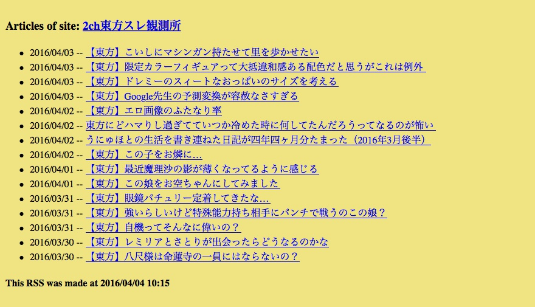

RssReaderTry
===

Rssリーダを作ってみる。DB接続とか feedparser とか webbrowser とか。

フィード (RSS / Atom) を読んで記事一覧の HTML を書き出す CLI。読んだ内容は SQLite にキャッシュして、6 時間以内ならネットに行かずキャッシュから作る。

- Docker: 対応!
- Python: 3.15!
- Linter: Ruff + mypy!
- Test: pytest!
- feedparser: 6.0!

## パッと実行してみたい

```bash
docker build -t rss-reader-try .

# 同梱のサンプルフィード (ネット不要) を読んで ./html/ に HTML を書き出す
docker run --rm --user "$(id -u):$(id -g)" -v "$PWD:/data" rss-reader-try examples/sample-feed.xml
# fetched: 3 articles from "Sample Feed" -> html/Sample-Feed.html

# もう一度実行すると、6 時間以内なのでキャッシュ (./my_rss.sqlite3) から作る
docker run --rm --user "$(id -u):$(id -g)" -v "$PWD:/data" rss-reader-try examples/sample-feed.xml
# cache: 3 articles from "Sample Feed" (fetched 2026/10/13 07:15 UTC) -> html/Sample-Feed.html

# 本物のフィードも読める (ページの URL でも、フィードを案内していればそれを読む)。
# いくつも渡すと、まとめページ html/index.html も作る
docker run --rm --user "$(id -u):$(id -g)" -v "$PWD:/data" rss-reader-try examples/sample-feed.xml https://qiita.com/mpyw/feed.atom
# cache: 3 articles from "Sample Feed" (fetched 2026/10/13 07:15 UTC) -> html/Sample-Feed.html
# fetched: ... articles from "mpywの記事 - Qiita" -> html/mpywの記事-Qiita.html
# index: 2 pages -> html/index.html
```

`html/Sample-Feed.html` をブラウザで開くと、こんな感じの記事一覧が見える。



## 使い方

```
rss-reader-try [-h] [--db DB] [--out OUT] [--max-age HOURS] [--open] FEED [FEED ...]
```

| 引数 | 既定値 | 説明 |
| --- | --- | --- |
| `FEED` | (必須) | フィードの URL (`http://` / `https://`) かローカルファイルのパス。フィードを `<link rel="alternate">` で案内しているページの URL でもいい。いくつでも (同じものは 1 回だけ読む) |
| `--db` | `my_rss.sqlite3` | キャッシュ用 SQLite ファイル。なければ作る |
| `--out` | `html` | HTML の出力先ディレクトリ。なければ作る |
| `--max-age` | `6` | キャッシュの有効期間 (時間)。`0` なら毎回取りに行く |
| `--open` | なし | 書き出した HTML (フィードが 2 つ以上なら `index.html`) をブラウザで開く (Docker の外で動かすとき用) |

- フィードごとに `fetched:` (取りに行った) か `cache:` (キャッシュから作った) で始まる 1 行を出す。
- フィードが読めない (ファイルがない、HTTP エラー、フィードじゃない、など) ときは `error:` で始まるメッセージを標準エラーに出す。ほかのフィードはそのまま続ける。
- フィードを 2 つ以上渡すと、書き出したページへのリンク集 `index.html` も作って `index:` の行を出す。
- 終了コードは、全部うまくいけば 0、読めないフィードが 1 つでもあれば 1。
- 取りに行くときは前回の `ETag` / `Last-Modified` を送る。サーバが「変わってない」(304) と返したらキャッシュの記事をそのまま使って `fetched: ... (not modified) -> ...` を出す。
- 取りに行って失敗しても、古いキャッシュがあればそれで HTML を作る。このときは `warning:` を標準エラーに出して `cache:` の行を出す (終了コード 0)。
- 引数がおかしい (`--max-age -1` など) ときは使い方を出して終了コード 2。
- 出力ファイル名はフィードのタイトルから作る (記号は `-` に置き換え)。1 回の実行でかぶったら `-2` などを付ける。

Docker を使わないなら [uv](https://docs.astral.sh/uv/) で。

```bash
uv run rss-reader-try --open examples/sample-feed.xml
```

## 開発

```bash
# lint (Ruff)、型チェック (mypy)、テスト (pytest) を Docker で回す
docker build --target dev -t rss-reader-try:dev .
docker run --rm rss-reader-try:dev

# できあがったイメージを、ローカルの HTTP サーバ (コンテナ) 相手に動かして確かめる (ネット不要)
docker build -t rss-reader-try .
scripts/e2e.sh
# ok   fetch over HTTP
# ok   second run uses the cache
# ...

# 依存ライブラリに既知の脆弱性がないか調べる (要ネット)
docker run --rm rss-reader-try:dev uv audit --locked --preview-features audit-command
```

CI (GitHub Actions) でも同じものを回している。

## セキュリティまわり

- フィードの中身は HTML エスケープしてから埋め込む。リンクは `http` / `https` だけ有効にする。
- HTML には Content-Security-Policy を付けてスクリプトを動かさない。
- 出力ファイル名に `/` や `..` が入らないようにしている。
- ターミナルに出すメッセージからは制御文字 (エスケープシーケンスなど) や文字の向きを変える文字を `?` に置き換える。フィードのタイトルでターミナルをいじられないように。
- フィードの取得にはタイムアウト (30 秒) とサイズ上限 (10 MB) がある。リダイレクトは `http` / `https` だけ追う。
- Docker イメージは Alpine ベースで小さめ (Debian slim より OS パッケージの既知脆弱性がずっと少ない)。root ではないユーザで動く。`--read-only --cap-drop ALL --security-opt no-new-privileges` を付けても動く (CI で確認している)。
